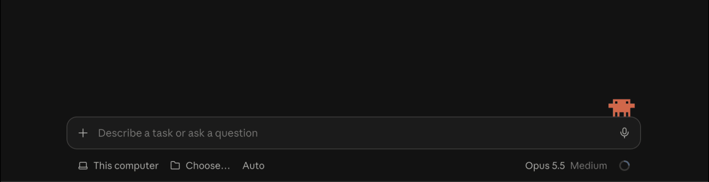
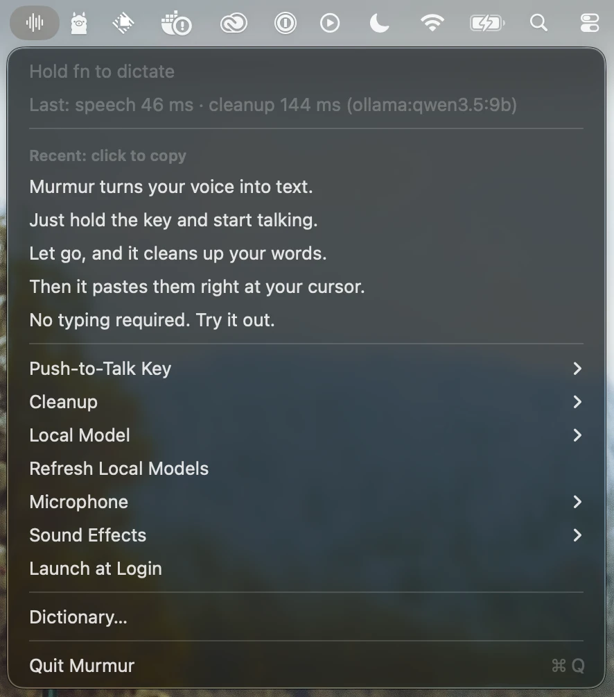
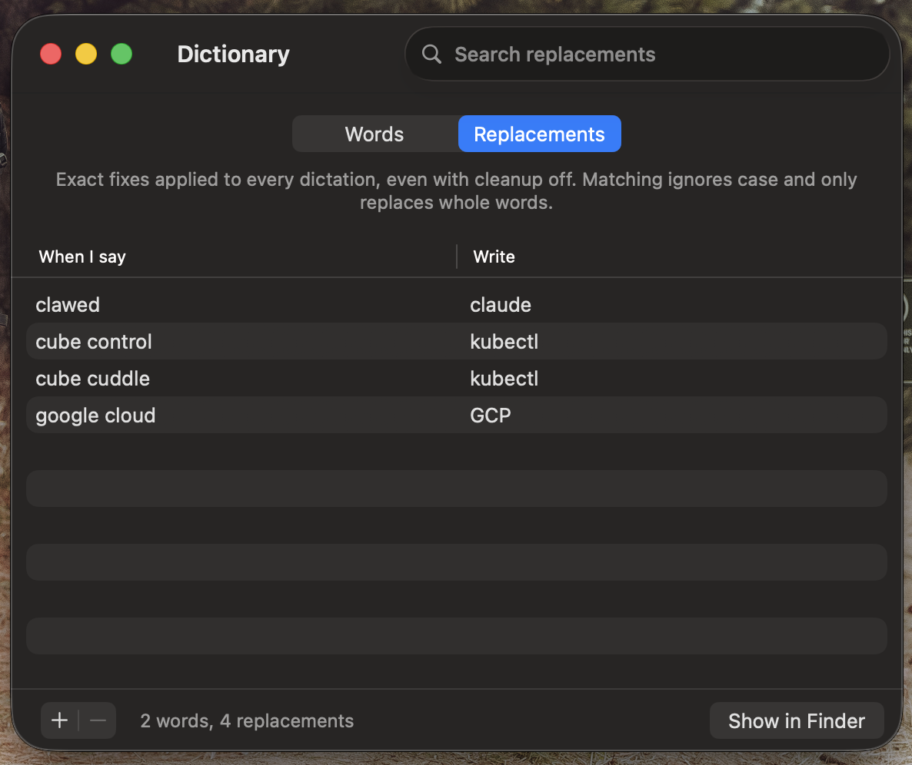

# Murmur

Push-to-talk dictation for macOS and Linux (Hyprland). Hold a key, speak, and polished text appears wherever your cursor is.

<p align="center">
  
</p>

The pipeline:

```
hotkey ─▶ mic capture ─▶ on-device STT ─▶ Claude cleanup ─▶ paste into frontmost app
                         (Parakeet, CPU)   (Haiku 5.5)
```

Most of the quality comes from the cleanup pass. It fixes misheard words, drops filler and false starts, keeps only the final version of a self-correction, adds punctuation, and formats spoken lists as markdown when the target app allows it.

## Layout

| Folder | What |
|---|---|
| [`rust/`](rust) | **Murmur.** One Rust workspace for both platforms: the macOS menu-bar app and the Linux daemon share the dictation engine, cleanup prompt, Dictionary and speech model. Crates are described in [`rust/README.md`](rust/README.md) and [`rust/CONTRACTS.md`](rust/CONTRACTS.md). |
| [`rust/linux/`](rust/linux) | Linux setup: the install script, Hyprland bindings and the Omarchy pill and bar menu. Start with [`rust/linux/README.md`](rust/linux/README.md). |
| [`App/`](App), [`Core/`](Core) | The original Swift macOS app and its `MurmurKit`/`MurmurCore` packages. Kept until the eval and the release scripts move to Rust; `Core/Sources/MurmurKit/CleanupPrompt.swift` is still the prompt's reference copy (see [The Swift app](#the-swift-app)). |
| [`Eval/`](Eval) | Swift CLI harness that scores speech engines and the cleanup prompt against recordings of your voice. macOS only. |

## macOS

You need [Rust](https://rustup.rs) (`rustup default stable`) and a code-signing certificate: an Apple Development one, or a self-signed one (see [below](#signing-without-an-apple-account)).

```bash
MURMUR_SIGN_IDENTITY="Apple Development: …" rust/scripts/bundle-macos.sh   # release build, signed rust/target/Murmur.app
open rust/target/Murmur.app
tail -f ~/Library/Logs/Murmur/murmur.log
```

The first launch downloads the Parakeet model (~480 MB). Allow **Microphone** and turn on Murmur under **System Settings › Privacy & Security › Accessibility**. Accessibility lets Murmur see the push-to-talk key and paste at your cursor. Both permissions persist across rebuilds as long as you sign with the same certificate. Store your [API key](#api-key) for Claude cleanup. The menu's **Launch at Login** starts it with your Mac.

If the Swift Murmur is installed, quit it first: both listen for fn. The Rust app's bundle ID is `com.plyhdrn.murmur-rs`, so it has its own permission grants; the Dictionary and API key are shared.

Hold **fn** (changeable in the menu), speak, and release. The text is pasted wherever your cursor is.

<p align="center">
  
  &nbsp;&nbsp;
  
</p>

- **fn key:** set **System Settings › Keyboard › "Press 🌐 key to"** to **Do Nothing**, or macOS will open the emoji picker or its own dictation. You can pick Right ⌥ or Right ⌘ instead. A quick fn tap (under 200 ms) is left alone, so it still works as the Globe key.
- **Chords are ignored:** typing another key while holding the hotkey (e.g. ⌥← to jump words) cancels the recording.
- **Context:** the frontmost app sets the cleanup style. Slack and Messages get chat style, Mail gets email, Notes and Obsidian get markdown notes, editors and terminals get code.
- **Cleanup** (menu): **Claude Haiku** (cloud, most reliable, ~1.3 s), **Local Model** via Ollama (default `qwen3.5:9b`, ~250 ms, occasional slips such as an invented heading or a dropped "yeah"; `ollama pull qwen3.5:9b` first), or **Off** (paste Parakeet's transcript as-is). The menu shows how long the last dictation's speech and cleanup steps took.
- **Fallbacks:** if cleanup fails (no API key, Ollama not running), Murmur pastes the raw transcript and says so. Without Accessibility, it copies the text so you can ⌘V.
- **Dictionary** (menu › Dictionary…): **Words** are spellings to prefer (names, jargon), used by the cleanup step to fix near-misses. **Replacements** are exact "when I say X, write Y" fixes, applied to every dictation even with cleanup off; they ignore case and match whole words only. Both live in `~/Library/Application Support/Murmur/dictionary.json`, which you can also edit by hand; changes apply on the next dictation.
- **Microphone** (menu): System Default or any connected mic. Murmur remembers your choice without changing the system-wide default, and uses the default while that mic is unplugged.
- **Sound Effects** (menu): a start and stop sound in one of four styles, all synthesized in code: **Wood** (low, woody; default), **Soft** (pure round tones with a faint grace note), **Chime** (bright, bell-like) or **Bubble** (a single note that swoops up or down). Picking one plays a preview.
- **Clipboard:** the dictated text stays on the clipboard after pasting, so you can paste it again (or yourself, if no text field had focus).
- **Settings** live in `~/Library/Application Support/Murmur/settings.json`.

### Signing without an Apple account

A self-signed certificate is only trusted on the Mac that made it, which is all a local build needs, and macOS keeps the permissions across rebuilds as long as you keep the certificate.

1. In **Keychain Access**, choose **Keychain Access › Certificate Assistant › Create a Certificate…**. Name it `Murmur Self-Signed`, set **Identity Type** to **Self-Signed Root** and **Certificate Type** to **Code Signing**, and click **Create**.
2. Build with it: `MURMUR_SIGN_IDENTITY="Murmur Self-Signed" rust/scripts/bundle-macos.sh`. The first signing may ask to use the certificate's key; choose **Always Allow**.

## Linux

The same `murmur` binary is a daemon and command-line tool for Hyprland, driven by key bindings, with an Omarchy pill and bar menu. Setup, bindings and troubleshooting are in [`rust/linux/README.md`](rust/linux/README.md):

```bash
rust/linux/install.sh   # release build to ~/.local/bin/murmur, plus the Omarchy plugin
murmur doctor
```

## API key

Create a key at [platform.claude.com](https://platform.claude.com/settings/keys). `ANTHROPIC_API_KEY` in the environment overrides the stored key if set.

On macOS, store it in your login Keychain. The command prompts for the key, so it never lands in shell history; add `-U` to replace a stored key:

```bash
security add-generic-password -s com.plyhdrn.murmur -a anthropic-api-key -w
```

On Linux, it's read from the Secret Service keyring; [`rust/linux/README.md`](rust/linux/README.md) has the command.

## Eval harness

Still Swift, so it runs the Swift engines (Parakeet on the Neural Engine through FluidAudio, and Apple's speech) rather than the Rust app's sherpa-onnx build; the cleanup prompt is byte-for-byte the same, so prompt results carry over. Requires macOS 26 and Xcode 26. The first run downloads the Parakeet models (~500 MB) and Apple's speech assets. It uses the same [API key](#api-key).

```bash
cd Eval
swift build

# Record clips. After each one, type what you said verbatim (for WER) and what you'd want typed.
.build/debug/MurmurEval record standup --context chat
.build/debug/MurmurEval record todo-list --context notes

# Transcribe every clip with each engine, clean each transcript, and write a report to results/.
.build/debug/MurmurEval run
.build/debug/MurmurEval run --engines parakeet,parakeet-ultra,apple

# Time a cleaner on built-in test dictations: claude (default) or ollama:<model>.
.build/debug/MurmurEval bench --cleaner ollama:qwen3.5:9b

# Try the cleanup pass without audio. Add --prompt draft.md to test a prompt edit.
.build/debug/MurmurEval clean "um so first update the readme second tag the release" --context notes
```

Run the binary directly rather than `swift run`, so macOS attributes the mic prompt to your terminal.

- **Clips** live in `Eval/clips/` as `<name>.wav` plus a `<name>.json` sidecar (`reference`, `intended`, `context`). Any `.wav`/`.m4a` you drop in works too. Audio is gitignored.
- **Contexts**: `plain`, `chat`, `email`, `notes`, `code`. They set how the cleanup pass formats output.
- **Dictionary**: every command uses the app's dictionary (`dictionary.json`) so results match real use. Pass `--dictionary <file>` to try another, or `--dictionary none` for none.
- **Cleanup prompt**: edit `Core/Sources/MurmurKit/CleanupPrompt.swift` and `rust/crates/murmur-core/src/prompt.rs` together; a Rust test fails if they differ. Try a draft first with `--prompt draft.md`.

## The Swift app

The original macOS app, in `App/` and `Core/`. It's still what `scripts/release.sh` publishes and `scripts/get.sh` installs, until those move to Rust.

```bash
brew install xcodegen   # once
echo 'DEVELOPMENT_TEAM = <your Team ID>' > App/Signing.local.xcconfig   # once; see App/Signing.xcconfig
./scripts/install.sh    # build Release, install to /Applications (~/Applications without admin rights), launch
```

It needs Xcode 26. If `xcodebuild` says it needs Xcode rather than the Command Line Tools, run `sudo xcode-select -s /Applications/Xcode.app`, or without admin rights, `export DEVELOPER_DIR=/Applications/Xcode.app/Contents/Developer`. To sign with the [self-signed certificate](#signing-without-an-apple-account) instead of a Team ID:

```bash
printf 'MURMUR_SIGN_IDENTITY = Murmur Self-Signed\nDEVELOPMENT_TEAM =\n' > App/Signing.local.xcconfig
```

### Other Macs

To use Murmur on a Mac that doesn't build it, publish a build from this one and install it there with a script. Releases are public, so `release.sh` only publishes builds signed with a **Developer ID Application** certificate (from the paid Apple Developer Program). It refuses Apple Development and self-signed builds, which are for your own Macs. Set `DEVELOPMENT_TEAM` to the team that owns the certificate; the script shows who signed the build and asks before publishing.

```bash
./scripts/release.sh    # here: build the current commit and publish it as a GitHub Release
```

On the other Mac (Apple Silicon, macOS 26), run this to install, and again to update. It needs no admin rights; without them it installs to `~/Applications`:

```bash
curl -fsSL https://raw.githubusercontent.com/andersryanc/murmur/main/scripts/get.sh | zsh
```

Releases aren't notarized yet. That's fine for `get.sh`, because `curl` doesn't quarantine what it downloads, so Gatekeeper doesn't check it; a copy downloaded in a browser would be blocked (System Settings › Privacy & Security › **Open Anyway** lets it through). Grant Microphone and Accessibility on first launch; updates keep them as long as they're signed with the same certificate. A renewed certificate makes macOS ask again. Store the [API key](#api-key) on that Mac too (`get.sh` reminds you). A managed work Mac may still refuse to run the app or to turn on Accessibility, depending on its policies.
